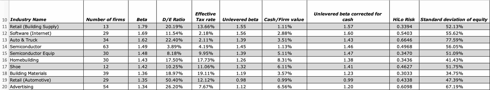
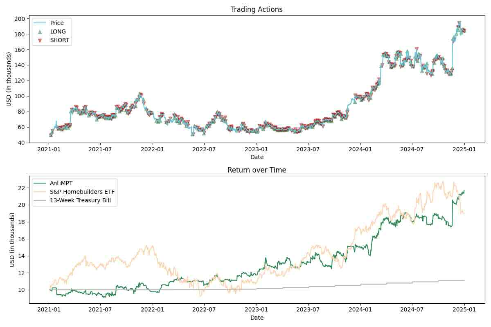
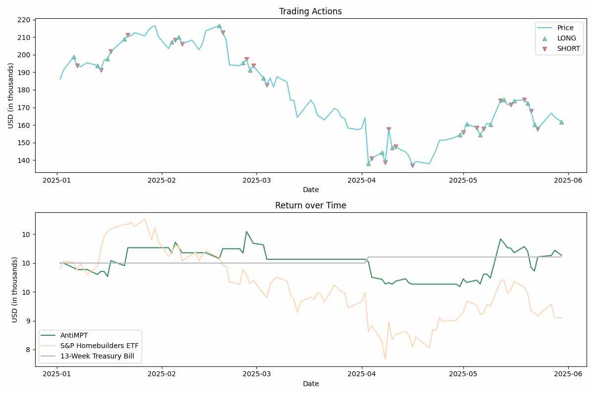
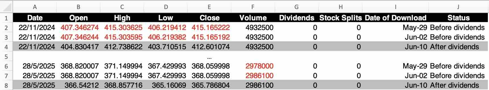
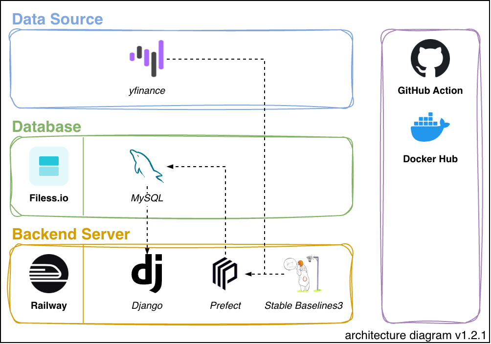

<!-- INTRODUCTION -->
# 💸 Anti-MPT
[Modern Portfolio Theory](https://en.wikipedia.org/wiki/Modern_portfolio_theory) (MPT //_empty_//) is a widely used framework in finance that helps investors make informed decisions about their investments. It emphasises the importance of diversification and the trade-off between risk and return. However, as the pronunciation suggests, it would rather empty your portfolio than make you a millionaire.

In contrast, Anti-MPT is risk-seeking and argues against the diversification emphasised in MPT. It trades one and only one stock frequently, aiming to re-enact the "buy low, sell high" strategy as much as possible. It embraces volatility to fill your pockets with cash, for _anti-empty_ is the name of the game.

  

  
  
  
<strong>First Published:</strong> 17 June 2025 <strong>Last Updated:</strong> 11 October 2026

<!-- ROADMAP -->
## Table of Contents
- [1 - Why We Built Anti-MPT](#1)
- [2 - How Should I Trade This Stock?](#2)
    - [2.1 - Survive Market Uncertainty](#2.1)
    - [2.2 - Understand Agnostic Results](#2.2)
- [3 - Behind the Scenes](#3)

<!-- SECTION 1 -->

## Why We Built Anti-MPT
No matter how many years you have been working, you still won't be able to build your nest egg unless Li Ka-Shing is your father. Many people start their journey in the stock market with the vain hope of becoming wealthy. However, they soon realise that the stock market is not as easy as they thought. It is extremely exhausting and difficult to make money in the stock market.

MPT emphasises diversification in investing to balance risk and return. Because its pronunciation sounds like _empty_, it will eventually _empty_ your portfolio after some time. Anti-MPT goes against the concepts introduced in MPT. It leverages reinforcement learning (RL) to identify positions that can generate the highest returns, ultimately outperforming ETF funds.

  
  
<i>you jump, but I'm not going to be nuts with you.</i>

<!-- SECTION 2 -->

## How Should I Trade This Stock?
Anti-MPT focuses on a single stock and trades it frequently. The strategy is simple: buy low and sell high. Everyone knows it, but no one can implement it in practice. Therefore, Anti-MPT leverages RL to determine the appropriate actions to maximise returns.

To re-enact the strategy as much as possible, the selected stock should have high volatility and high returns. According to [Aswath Damodaran](https://pages.stern.nyu.edu/~adamodar/New_Home_Page/datafile/Betas.html), the _Building Supply_ sector has the highest beta among all industries as of January 2025. Anti-MPT favours [NYSE:WSM](https://finance.yahoo.com/quote/WSM/) because it has the highest Compound Annual Growth Rate within the industry. To compare the performance of Anti-MPT, the [S&P 500 Homebuilders Index](https://finance.yahoo.com/quote/XHB/) serves as a benchmark. While it is not a complete proxy for MPT, it is a relevant reference index.

  
  
<i>the bigger the risk, the bigger the reward.</i>

### Survive Market Uncertainty
Multiple RL agents are trained on 10 years (2010 - 2020) of trading data and are ensembled to vote for the best actions for Anti-MPT. As of May 2025, Anti-MPT has outperformed the proxy in both the development (2021 - 2024) and test (January - May 2025) sets. Anti-MPT has demonstrated a strong ability to handle market uncertainty, even under the Liberation Day championed by Donald Trump. On the other hand, MPT, which refers to the S&P Index, has been severely impacted by the market and liberates your portfolio. That’s why we say MPT empties your pockets!

  
    
    
  
  
<i>backtests on the development and test sets, respectively.</i>

Going forward, Anti-MPT will continuously manage trades, and its performance will be available on its [dashboard](https://antimpt.up.railway.app/).

> [!NOTE]  
> Latency is expected for Anti-MPT relies on community servers and may need to wake a sleeping instance, which can add extra loading time.

> [!CAUTION]  
> Anti-MPT does not provide financial advice. Any actions taken based on the information presented in the dashboard are at your own risk.

### Understand Agnostic Results
Never take it too seriously. RL is indeed a powerful tool, but it is like a black box. You cannot explain why it sometimes buys high and sells low. Agents rely heavily on luck, just like [Ethan Hunt](https://youtu.be/XAYhNHhxN0A?si=WRiahZjU0rEeWenB). Anti-MPT has a fundamental issue: it is trained on Yahoo Finance data. It is not uncommon for prices to be adjusted due to [corporate actions](https://ir.homedepot.com/stock-information/dividend-history), but the data provided by Yahoo Finance is inconsistent over time (reference: [here](https://github.com/ranaroussi/yfinance/issues/626), [here](https://github.com/ranaroussi/yfinance/issues/1871), and [more](https://stackoverflow.com/questions/62999147/inconsistent-data-being-downloaded-from-yahoo-finance-website)...).

Ages ago, a finance professor introduced a [concept](https://massive.com/blog/greeks-and-implied-volatility): _the wrong number to put in the wrong formula to get the right price_. To us, it feels like ???????????????. It is a bit controversial, but what we have learnt is that _garbage in, garbage out_. This may be the reason why he is so smart, so rich, so handsome, and so powerful, while we are not. However, we agree with Immanuel Kant that we have limits to what we can know, so we think it is okay to let Anti-MPT be like that.

  
  
<i>your mission, should you choose to accept it.</i>

<!-- SECTION 3 -->

## Behind the Scenes
Anti‑MPT relies on market data from **Yahoo Finance**, focusing on [WSM](https://finance.yahoo.com/quote/WSM/) (Williams‑Sonoma, Inc.), [XHB](https://finance.yahoo.com/quote/XHB/) (SPDR S&P Homebuilders ETF), and [IRX](https://finance.yahoo.com/quote/^IRX/) (13‑week Treasury bill rate). These tickers power the Anti‑MPT trading dashboard.

After each market close, a scheduled job orchestrated by **Prefect** fetches the latest data and updates Anti‑MPT’s signals to avoid presenting intra‑day moves as financial advice. Trading history is persisted in **MySQL** and served through a **Django** backend, which drives a browser‑based dashboard for reviewing and analysing performance.

The web app runs on a **Railway** Free Plan and the database is hosted on the **Filess.io** free tier. Due to free‑tier limits, downtime and delayed updates may occur, and the dashboard may not refresh immediately after the trading day.

  

<!-- DISCLAIMER -->
---

**This was created as a personal hobby project and learning exercise.**
